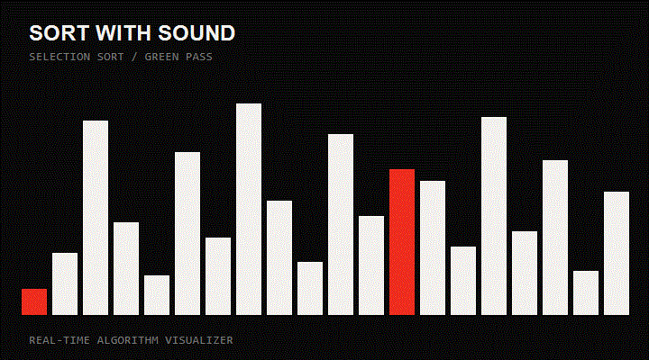

# Sort With Sound

An interactive sorting visualizer that turns algorithms into an audiovisual experience. Watch data move in real time and hear tones that follow the values being compared and rearranged.



> **Live demo:** not published yet. Add the Vercel URL here after the first deploy (see [Deploying to Vercel](#deploying-to-vercel)).

## Features

**Visualization**

- Ten sorting algorithms, each replayed step by step
- Race mode: run two algorithms side by side on the same data and see which finishes in fewer steps
- Highlighted working range for Merge Sort and Quick Sort, plus pivot and sorted markers
- Green completion pass from the smallest value to the largest
- Complexity card (best / average / worst / space / stability) for each selected algorithm

**Playback**

- Start, pause, resume, and reset
- Timeline scrubber with step-back and step-forward buttons
- Three tempos, adjustable while a sort is running
- Live comparisons, swaps, step, and elapsed-time metrics

**Data**

- Reproducible arrays from a seed, or a fresh random seed with one click
- Four data patterns: random, reversed, nearly sorted, few unique
- Array size from 16 to 80 values

**Sound**

- Tones generated with the Web Audio API, one per value being compared or moved
- Volume control and four waveforms (sine, triangle, square, sawtooth)
- In race mode the two algorithms are panned left and right

**Sharing**

- The algorithm, race opponent, data pattern, seed, size, and tempo are stored in the URL, so any link reproduces the same run
- `Copy share link` copies the current URL

## Keyboard Shortcuts

| Key | Action |
| --- | --- |
| `Space` | Start / pause / resume |
| `←` `→` | Step back / forward |
| `R` | Reset to the unsorted array |
| `N` | New random data |
| `M` | Mute / unmute |

Shortcuts are ignored while typing in the seed field or using a dropdown.

## Algorithms

| Algorithm | Best | Average | Worst | Space | Stable |
| --- | --- | --- | --- | --- | --- |
| Bubble Sort | O(n) | O(n²) | O(n²) | O(1) | Yes |
| Selection Sort | O(n²) | O(n²) | O(n²) | O(1) | No |
| Insertion Sort | O(n) | O(n²) | O(n²) | O(1) | Yes |
| Quick Sort | O(n log n) | O(n log n) | O(n²) | O(log n) | No |
| Merge Sort | O(n log n) | O(n log n) | O(n log n) | O(n) | Yes |
| Heap Sort | O(n log n) | O(n log n) | O(n log n) | O(1) | No |
| Shell Sort | O(n log n) | gap-dependent | O(n²) | O(1) | No |
| Cocktail Shaker Sort | O(n) | O(n²) | O(n²) | O(1) | Yes |
| Comb Sort | O(n log n) | O(n² / 2ᵖ) | O(n²) | O(1) | No |
| Gnome Sort | O(n) | O(n²) | O(n²) | O(1) | Yes |

Quick Sort uses the last element as its pivot, so the `Reversed` and `Nearly sorted` patterns show its worst case.

## Getting Started

Requirements: Node.js 20 or newer, and npm.

```bash
npm install
npm run dev
```

Then open <http://localhost:5004/>.

| Command | What it does |
| --- | --- |
| `npm run dev` | Start the development server on port 5004 |
| `npm run build` | Type-check and build for production into `dist/` |
| `npm run preview` | Serve the production build locally |
| `npm run test` | Run the tests in watch mode |
| `npm run test:run` | Run the tests once |

## Deploying to Vercel

The repository is ready to deploy as a static Vite site. [vercel.json](vercel.json) sets the framework, the install and build commands, the `dist` output directory, and long-lived caching for the hashed files in `/assets`. No environment variables are needed.

### Option 1: Git integration

1. Push the repository to GitHub, GitLab, or Bitbucket.
2. In Vercel, choose **Add New → Project** and import the repository.
3. Leave the detected settings as they are and click **Deploy**.

Every push to the default branch then deploys to production, and every other branch gets a preview URL.

### Option 2: Vercel CLI

```bash
npm i -g vercel
vercel          # preview deployment
vercel --prod   # production deployment
```

### Notes

- Vercel installs with `npm ci`, so commit `package-lock.json` and keep it in sync with `package.json`.
- The app is a single page with no client-side routes, so no rewrite rules are required. Share links work because the settings are in the query string.
- Browsers only start audio after a user gesture. Sound begins with the first click or key press, which is expected.

## Using the Seed System

Enter a value in the `Seed` field and click `Generate from seed` to create a deterministic array.

- The same seed, size, and data pattern always produce the same array.
- `Random` draws a new seed and generates a fresh array.
- `Reset data` rewinds to the unsorted array without changing the data.
- A seed typed into the field is not applied until you click `Generate from seed`.

Example seed:

```text
demo-42
```

## Project Structure

```text
public/                       # Favicon and demo GIFs
scripts/                      # Demo GIF capture scripts

src/
├── algorithms/
│   ├── sortSteps.ts          # Sorting algorithms and visualization steps
│   └── algorithmInfo.ts      # Labels, complexity, and descriptions
├── audio/
│   └── soundEngine.ts        # Web Audio API sound engine
├── components/
│   ├── AlgorithmInfo.tsx     # Complexity cards
│   ├── ControlPanel.tsx      # Algorithm, data, sound, and playback controls
│   ├── MetricsBar.tsx        # Sorting metrics
│   ├── SortStage.tsx         # Bar visualization
│   └── Transport.tsx         # Timeline scrubber and step buttons
├── utils/
│   ├── completion.ts         # Order of the green completion pass
│   ├── random.ts             # Seeded random generator and data patterns
│   └── shareLink.ts          # URL parsing and building
├── types/sorting.ts          # Shared types
├── App.tsx                   # Application state and playback
└── styles.css                # Responsive visual design

vercel.json                   # Vercel build and caching configuration
```

Tests sit next to the code they cover as `*.test.ts` / `*.test.tsx`.

## How It Works

Each algorithm produces a complete `SortStep[]` list up front. Every step holds a snapshot of the array, the active indices, the sorted indices, pivot and range information when applicable, and running metrics.

Playback is a cursor into that list. A timer advances the cursor at the selected tempo, and the scrubber, step buttons, and arrow keys move it directly, which is why a run can be stepped backwards. In race mode both algorithms share one cursor, and the one with fewer steps finishes first.

## Tech Stack

React, TypeScript, Vite, Vitest, Testing Library, and the Web Audio API.

## Accessibility

- All controls can be operated with the keyboard.
- Ready, running, paused, completing, and complete states are announced with text.
- Bar states are available to screen readers in addition to color changes.
- Reduced motion is respected through `prefers-reduced-motion`.

## License

No license has been selected for this repository yet.
